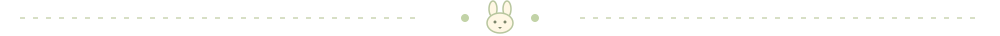

  

### 🐰 SMALL CLOUD LAB · 유은수

# 작은 구름에서 시작하는 단단한 AI 인프라 ☁️

**AI 인프라 엔지니어를 준비합니다.**  
GPU 자원 배분부터 배포 전 검사, LLM 서빙과 장애 분석까지 직접 실험하고 기록합니다.

[🌷 Notion 포트폴리오](https://app.notion.com/p/3e746d96621a81eb9138ec1a83f27415) · [🎬 15초 쇼릴](https://github.com/eunsu7997/eunsu7997/raw/main/assets/eunsu_showreel_2026_web.mp4) · [📒 실제 운영 일지](docs/kubellm-ops/2026-10-11-12-ops-log.md)

### 🌱 먼저 보는 실험 결과

| 실제 GPU · RTX 4060 | Kueue · KWOK 시뮬레이션 | 배포 전 검사 · 자동화 테스트 |
| :---: | :---: | :---: |
| **178 → 0초** | **243 → 121초** | **509개** |
| 선점 후 반복 학습 손실 감소 | 작업 완료 시간 단축 | GPUDeploy Guard 테스트 통과 |
| [체크포인트 실험 · n=3](https://github.com/eunsu7997/gpu-queue-lab/blob/main/evidence/real-gpu-v2/RESULTS.md) | [시뮬레이션 결과](https://github.com/eunsu7997/gpu-queue-lab/blob/main/evidence/sim/RESULTS.md) | [코드와 CI 확인](https://github.com/eunsu7997/gpu-deploy-guard) |

## 🏡 연구실의 네 가지 프로젝트

**🛡️ 배포 전 확인 → 🌱 자원 배분 → ☁️ 서빙 운영 → 🔎 장애 분석**

<table>
<tr>
<td width="50%" valign="top">

<h3>🛡️ 배포 전에 실패를 발견해요</h3>

GPU/LLM 워크로드가 실제로 올라갈 수 있는지 미리 검사하는 CLI.

<b>509개 테스트 · GitHub Actions 통과</b> 배포 전 검증과 결과 기록을 자동화합니다.

<a href="https://github.com/eunsu7997/gpu-deploy-guard">코드 · 테스트 · 사용 방법 ↗</a>

</td>
<td width="50%" valign="top">

<h3>🌱 쉬는 GPU를 함께 써요</h3>

Kueue로 유휴 GPU를 빌려 쓰고, 소유 팀의 요청이 오면 되돌려주는 작업 대기열.

<b>KWOK: 243 → 121초 · 사용률 50 → 98%</b> 실제 RTX 4060 실험: 체크포인트로 반복 학습 손실 178 → 0초.

<a href="https://github.com/eunsu7997/gpu-queue-lab">코드 · 환경별 실험 증거 ↗</a>

</td>
</tr>
<tr>
<td width="50%" valign="top">

<h3>☁️ 모델이 돌아가는 환경을 만들어요</h3>

RTX 4060·Docker·vLLM 서빙과 Prometheus/Grafana 관측, Kubernetes CPU/Mock 복구 실험.

<b>Docker: Gateway → vLLM 응답 · 관측 상태 확인</b> 검증 진행 중: readiness False 추적 · Kubernetes GPU Pod 미검증.

<a href="docs/kubellm-ops/2026-10-11-12-ops-log.md">운영 · 실패 · 보안 전환 기록 ↗</a> 현재 링크는 운영 일지이며 전용 소스 저장소는 아닙니다.

</td>
<td width="50%" valign="top">

<h3>🔎 장애 원인을 근거로 설명해요</h3>

LLM이 원인 후보를 제안하고, 코드가 근거를 검증하고, 사람이 최종 판단하는 장애 분석 도구.

<b>25개 테스트 · 실제 LLM 실행 증거 4건</b> 추측과 확인된 사실을 구분하는 분석 흐름을 만듭니다.

<a href="https://github.com/eunsu7997/incident-copilot">코드 · 분석 흐름 · 실행 증거 ↗</a>

</td>
</tr>
</table>

## 🧰 연구실에서 사용하는 도구

       

## 📖 실험을 대하는 태도

ITS 현장에서 CCTV·VMS 장비 장애를 직접 다뤄 본 경험을 바탕으로,  
**GPU를 놀리지 않고, 배포 전에 실패를 막고, 장애가 나도 근거로 설명할 수 있는 인프라**에 관심이 있습니다.

- **숫자에는 증거를 붙입니다.** 실행 기록과 CI 결과로 확인합니다.
- **환경과 한계를 함께 씁니다.** 시뮬레이션, 실제 GPU, 미검증 항목을 구분합니다.
- **실패도 남깁니다.** 재현 조건과 다음 개선 방법을 기록합니다.

### 🌼 지금 키우고 있는 것

- SK 알레프 AI 인프라 과정 수강 중
- RTX 4060에서 vLLM 서빙 · GPU 실험 · 운영 검증 진행 중

작은 실험이 쌓여, 단단한 시스템이 되어가요. 🐰🌱

