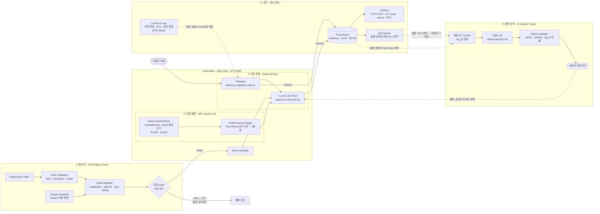
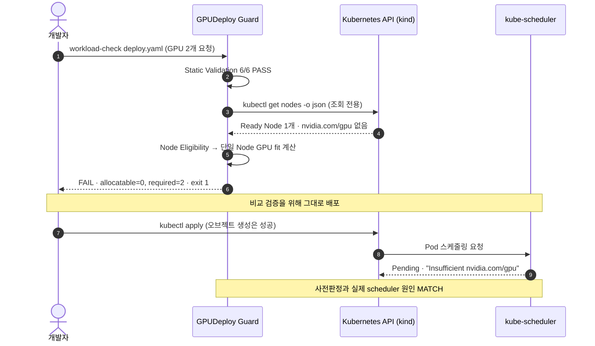
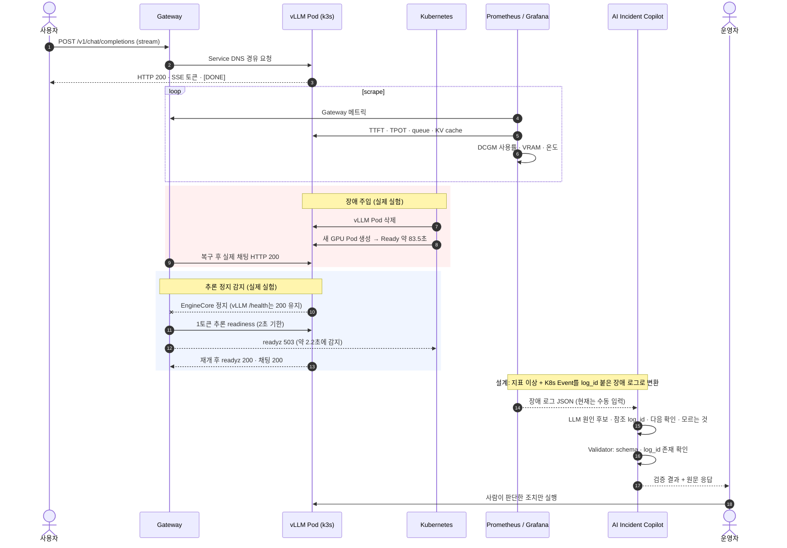

# AI Infra 통합 아키텍처 & 이력서 성과 문구

> 5개 프로젝트: GPUDeploy Guard · GPU Queue Lab · KubeLLM-Ops · LLM-SLO Lab · AI Incident Copilot
>
> **작성 원칙:** 모든 수치는 각 프로젝트 저장소의 evidence와 Notion 검증 기록에 있는 값만 사용했습니다. 실제 실행과 시뮬레이션은 구분해서 적었고, 아직 구현하지 않은 연결은 점선과 「설계」로 표시했습니다. (기준일 2026-10-22)

---

## 1. 한눈에 보기

5개 프로젝트는 각각 별도 저장소에서 검증했습니다. 이 문서는 그 프로젝트들을 **하나의 LLM 서빙 운영 흐름**으로 이어서 보여 줍니다.

| 단계 | 프로젝트 | 푸는 문제 | 검증 수준 |
|---|---|---|---|
| ① 배포 전 | **GPUDeploy Guard** | YAML은 적용되지만 GPU·selector·affinity·taint 때문에 Pod가 Pending이 됨 | kind 실제 API + scheduler 원인 MATCH · 509 tests |
| ② 자원 배분 | **GPU Queue Lab** | GPU를 고정 배분하면 놀고, 선착순이면 독차지함 | KWOK → kind → 실제 RTX 4060(k3s) |
| ③ 서빙 운영 | **KubeLLM-Ops** | 서빙이 죽거나 멈춰도 health는 200일 수 있음 | WSL k3s + RTX 4060 실제 vLLM 추론·복구 |
| ④ 성능·SLO | **LLM-SLO Lab** (+ KubeLLM-Ops SLO-Guard) | 단발 벤치마크로는 측정 변동과 실제 회귀를 구분하기 어려움 | CPU Mock 반복 측정 · 실제 vLLM 적용은 다음 단계 |
| ⑤ 장애 분석 | **AI Incident Copilot** | LLM이 없는 근거를 인용하거나 그럴듯하게 틀림 | 실제 LLM 실행 증거 4건 · 25 tests |

---

## 2. 컴포넌트 다이어그램

실선은 각 프로젝트 안에서 실제로 실행해 확인한 흐름이고, 점선은 프로젝트끼리 잇기 위한 통합 설계(미구현)입니다.

---

## 3. 시퀀스 다이어그램 ① 배포 전 검증 (실제 실행)

GPUDeploy Guard 13단계에서 실제 kind 클러스터에 대해 실행한 흐름입니다.

---

## 4. 시퀀스 다이어그램 ② 서빙 · 관측 · 장애 대응

KubeLLM-Ops에서 실제로 확인한 흐름(실선)과 Incident Copilot까지 잇는 설계(Note로 표시)입니다.

---

## 5. 프로젝트 간 연결 지점

| 연결 | 현재 상태 | 근거 / 다음 단계 |
|---|---|---|
| GPUDeploy Guard → Kubernetes | ✅ kind에서 실제 판정 · scheduler 원인 MATCH | 실제 GPU Node에서 PASS 경로는 미검증 → k3s 환경에서 재검증 가능 |
| GPU Queue Lab → GPU 슬롯 | ✅ k3s + time-slicing 실제 RTX 4060 | MPS는 WSL2에서 불가, 설정만 준비 |
| KubeLLM-Ops → Prometheus/Grafana | ✅ Gateway·vLLM·DCGM 3 target UP, TTFT/TPOT 패널 | DCGM 전력은 WSL에서 N/A |
| LLM-SLO Lab → 실제 vLLM | ⏳ 설계 | 현재 CPU Mock. RTX 4060 vLLM에 SSE 기반 TTFT/TPOT 측정 추가 예정 |
| SLO / 메트릭 → Incident Copilot | ⏳ 설계 | 현재 장애 로그 JSON 수동 입력 |
| Copilot → 자동 조치 | ❌ 의도적으로 하지 않음 | AI는 후보 제시, 코드는 근거 검증, 조치는 사람이 결정 |

---

## 6. 이력서 / 포트폴리오용 STAR Bullet Points (10개)

### GPUDeploy Guard — 배포 전 검증

**1. GPU 워크로드 배포 사전검증 CLI 개발**
- **S** Kubernetes YAML이 문법상 맞아도 GPU capacity·nodeSelector·affinity·taint 조건이 맞지 않으면 Pod가 Pending에 머묾
- **T** 정적 설정 오류와 실제 클러스터 상태를 나눠 검사하고, 배포 전에 스케줄링 실패를 판정하는 rule 기반 CLI를 만들어야 했음
- **A** Python으로 Static Validator(GPU·CPU/Memory·Probe)와 kubectl 조회 전용 Cluster Preflight를 분리 구현했고, 실제 kind 클러스터에서 사전판정과 kube-scheduler 결과를 비교함
- **R** GPU 2개 요청을 배포 전에 `allocatable=0, required=2`로 FAIL 판정했고, 실제 scheduler도 `Insufficient nvidia.com/gpu`를 반환해 **원인이 MATCH**함 · pytest **509개** · GitHub Actions CI 통과

**2. 단일 Node 기준 GPU 스케줄링 판정 로직 설계**
- **S** 클러스터 전체 GPU 합계로 판단하면 Node마다 1개씩 흩어진 GPU도 "충분"으로 잘못 판정됨
- **T** 실제 배치 후보가 되는 Node만 남긴 뒤 한 Node 안에서 GPU 요청량을 채울 수 있는지 판정해야 했음
- **A** nodeName → nodeSelector → Ready/cordon → NoSchedule·NoExecute taint/toleration → required nodeAffinity(term OR · expression AND, 6개 operator) 순서로 후보 Node를 줄이는 Eligibility Evaluator를 구현함
- **R** "GPU 1 + 1 Node에 2개 요청"을 FAIL로 판정했고, 기능을 늘리는 동안 테스트를 **343 → 509개**로 늘리면서 매 단계 전체 회귀를 통과함

### GPU Queue Lab — GPU 자원 배분

**3. Kueue 기반 GPU 공유 큐 설계**
- **S** 팀별 GPU를 고정 배분하면 쉬는 팀의 GPU가 놀고, 선착순이면 한 팀이 독차지함
- **T** 팀 몫은 보장하면서 남는 GPU를 빌려 쓰고, 주인 팀이 돌아오면 돌려받는 규칙을 만들고 수치로 증명해야 했음
- **A** Kueue ClusterQueue에 nominalQuota·cohort borrowingLimit·reclaimWithinCohort·WorkloadPriorityClass 4개 규칙을 설계하고, 측정 도구 `gpuq`(Python, 테스트 10개)를 직접 만들어 KWOK → kind 순서로 검증함
- **R** 가상 GPU 등록 환경(kind)에서 작업 4개 완료 시간 **250초 → 124초**, GPU 사용률 **50% → 98%**, 주인 팀 GPU 회수 **1~3초**

**4. 실제 RTX 4060에서 GPU 공유 효과를 반복 측정**
- **S** 가상 환경에서는 2배 빨라졌지만, 실제 GPU 1장을 나눈 슬롯에서도 같은 효과가 나오는지는 확인되지 않았음
- **T** 실제 학습 작업으로 time-slicing과 빌려 쓰기의 효과, 선점 손실을 재야 했음
- **A** WSL2 k3s에 NVIDIA Device Plugin time-slicing(GPU 1장 → 4슬롯)을 구성하고, 크기가 다른 PyTorch 학습 작업을 조건마다 3회 반복 측정함. SIGTERM을 받을 때 체크포인트를 저장하고 `os.replace`로 원자적으로 쓰도록 구현함
- **R** 학습 4개를 동시에 돌리면 처리량이 **24% 감소**함을 확인했고, 빌려 쓰기 효과는 작업 크기에 따라 **0~19%**, 체크포인트로 선점 손실을 **178초 → 0초**로 줄임

### KubeLLM-Ops — LLM 서빙 운영

**5. Kubernetes GPU 위에서 vLLM 서빙과 관측 환경 구축**
- **S** 모델이 Docker에서 응답하는 것만으로는 Kubernetes 운영 환경에서 서빙·관측이 되는지 알 수 없었음
- **T** 실제 GPU Pod에서 모델을 서빙하고, 요청부터 GPU 지표까지 한 흐름으로 관측해야 했음
- **A** WSL2 k3s + RTX 4060에 vLLM 0.30.0(Qwen2.5-0.5B-Instruct, 이미지 digest와 모델 revision 고정)을 배포하고, Gateway → Service DNS → vLLM 경로와 Prometheus(Gateway·vLLM·DCGM)·Grafana TTFT/TPOT·KV cache 패널을 구성함
- **R** 실제 채팅 **HTTP 200 · SSE [DONE]**, Prometheus **3개 target UP**, GPU 사용률·VRAM·온도 수집을 확인함. 동시성 1/2/4 부하에서 **36/36 성공**

**6. LLM 서빙 장애 주입과 복구 시간 측정**
- **S** GPU 부족, 모델 로딩 실패, Pod 종료가 실제로 어떻게 드러나고 얼마나 걸려 복구되는지 기록이 없었음
- **T** 장애를 안전하게 주입하고, 원래 상태로 되돌리는 절차까지 포함해 복구를 측정해야 했음
- **A** 원래 args 복구·UID 보호·dry-run을 갖춘 장애 스크립트를 작성하고, GPU 슬롯 부족·없는 offline 모델·API liveness 실패·vLLM Pod 삭제 4종을 실제로 주입함
- **R** Pod 삭제 후 새 GPU Pod Ready **약 83.5초**, liveness 재시작 후 Ready **약 210.3초**, 복구 후 실제 채팅 성공(각 1회 관측). EngineCore만 멈춘 경우 150초 안에 probe가 재시작하지 않는 **탐지 공백**을 발견해 기록함

**7. "health 200인데 추론 불가" 문제를 잡는 추론 readiness 구현**
- **S** Backend가 실패해 채팅이 502인데도 Gateway readiness는 200이었고, EngineCore가 멈춰도 vLLM `/health`는 200이었음
- **T** 실제 추론이 가능한지 확인하면서 서빙 부하는 늘리지 않는 readiness가 필요했음
- **A** 실제 1토큰 요청을 총 2초 기한으로 보내고, 5초 캐시와 프로세스별 lock을 적용한 opt-in inference readiness를 구현함. 사용자 승인 아래 실제 Docker vLLM EngineCore를 일시 정지해 검증함
- **R** 정지 중 readyz **503**(약 2.2초에 감지), 재개 후 **200**과 실제 채팅 복구를 확인함. 기존 health 3종은 정지 중에도 200이었음. 반복 Docker 부하 **216/216 성공**, 테스트 129개 통과

### LLM-SLO Lab — 성능·SLO 판정

**8. 반복 측정 기반 SLO·성능 회귀 판정기 개발**
- **S** 단발 벤치마크 숫자로는 측정 변동과 실제 성능 악화를 구분할 수 없었음
- **T** 같은 조건에서 반복 측정하고, 조건이 다르거나 근거가 부족하면 PASS를 내지 않는 판정기를 만들어야 했음
- **A** FastAPI CPU Mock과 httpx 비동기 부하 발생기를 만들고, P50/P95/P99·성공 RPS·오류율로 SLO를 `PASS / FAIL / UNVERIFIED` 판정하며 baseline 대비 회귀를 비교하도록 구현함. 실패 주입 하네스로 거짓 PASS 경로를 점검함
- **R** 지연 증가 실험에서 **P95 +33.4%, 성공 RPS −30.1%**를 FAIL로 탐지했고, 오류 증가 **+5.0%p**도 FAIL로 판정함. 조건 불일치와 반복 부족은 UNVERIFIED로 차단함 · pytest **223개** · 하네스 **21/21** (CPU Mock 기준이며 실제 vLLM·GPU 측정은 다음 단계)

### AI Incident Copilot — 장애 분석

**9. 근거 검증형 LLM 장애 분석 도구 개발**
- **S** LLM은 그럴듯한 장애 원인을 제시하지만, 입력에 없는 로그를 근거로 들 수 있음
- **T** 기계가 검증할 수 있는 부분과 사람이 판단해야 하는 부분을 나눈 운영 보조 도구가 필요했음
- **A** Python CLI에서 로컬 LLM(Ollama `llama3.2:1b`)이 원인 후보·참조 log_id·다음 확인·모르는 것을 JSON으로 답하게 하고, Validator가 JSON·schema·**log_id 실제 존재 여부**를 자동 검사하도록 구현함
- **R** pytest **25개**, GitHub Actions Python 3.11/3.12 통과. 실제 LLM 실행 결과 **4건**을 원문 그대로 evidence로 보존함

**10. AI 출력 평가에서 결과 선별 편향을 막는 절차 설계**
- **S** LLM은 실행할 때마다 답이 달라서, 다시 돌려 좋은 답만 고르면 성능이 부풀려짐
- **T** 결과를 보기 전에 기준을 고정하고, 실패도 그대로 남기는 평가 절차가 필요했음
- **A** 모델 실행 전에 평가 기준을 문서로 고정하고, 첫 응답을 재실행 없이 보존했으며, 사람이 원문을 다시 대조해 자동 검증이 놓친 반복 문장·외국어 혼입을 찾아냄
- **R** 6개 판정 중 **4개 충족 · 2개 미충족**을 그대로 기록했고, "형식 검증 → 근거 존재 검증 → 사람의 의미 판단"으로 검증 단계를 나눔

---

## 7. 이력서 상단 한 줄 요약

> Kubernetes GPU 환경에서 **배포 전 검증 → GPU 자원 배분 → vLLM 서빙·장애 복구 → SLO 판정 → LLM 장애 분석**까지 5개 프로젝트로 직접 구현하고, 실제 RTX 4060 측정과 시뮬레이션을 구분해 evidence로 검증한 AI 인프라 엔지니어 지망생

## 8. 면접에서 같이 말할 검증 경계

- GPU는 **RTX 4060 한 장**입니다. GPU=4는 time-slicing 슬롯이고 물리 GPU 4장이 아닙니다.
- 250초 → 124초는 **가상 GPU 등록(kind)** 결과입니다. 실제 GPU 효과는 0~19%로 따로 말합니다.
- LLM-SLO Lab 수치는 **CPU Mock** 결과입니다. TTFT/TPOT은 KubeLLM-Ops Grafana에서 따로 확인했습니다.
- 복구 시간은 **각 1회 관측**입니다. 장시간 안정성, 최대 처리량, 전력, production readiness는 미검증입니다.
- 프로젝트 간 자동 연동(SLO 위반 → Copilot 입력, 승인 후 자동 조치)은 **설계 단계**입니다.

## 9. 출처

- GPUDeploy Guard: https://github.com/eunsu7997/gpu-deploy-guard
- GPU Queue Lab: https://github.com/eunsu7997/gpu-queue-lab
- KubeLLM-Ops: https://github.com/eunsu7997/kubellm-ops (비공개)
- LLM-SLO Lab: https://github.com/eunsu7997/llm-slo-lab (비공개)
- AI Incident Copilot: https://github.com/eunsu7997/incident-copilot
