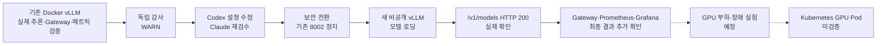
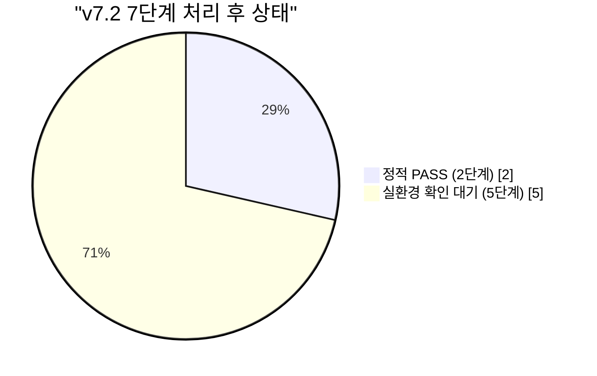

# KubeLLM-Ops 운영 일지 | 2026-10-11 ~ 10-12

> **상태 (10/12 대화 기록 기준):** RTX 4060에서 실제 vLLM/Qwen 모델 로딩과 비공개 컨테이너 내부 `/v1/models` HTTP 200을 확인했다. 예전 공개형 `8002` 포트는 검사 당시 닫혀 있었다. 새 Gateway·Prometheus·Grafana 전체 전환의 최종 성공 로그는 이 기록의 작성 시점에 확보하지 못했으므로 **추가 확인 필요**로 남긴다. Kubernetes GPU Pod 서빙과 GPU 부하·장애 실험 역시 미검증이다.

이 기록은 **AI 인프라 엔지니어 취업 포트폴리오**를 위한 작업 일지다. 해커톤 제출용 프로젝트로 바꾸지 않았다. 10월 11~12일 실제 터미널 출력과 독립 검수 보고서, 대화상 작업 결과를 구분해 적었다. 개인 PC의 상세 경로·비밀번호·원시 로그는 올리지 않았다.

## 작업 흐름



## 자동화 결과 그림 (실행과 검증을 구분)



- v6.1 이전 Codex/Claude 독립 검수에서는 **기존 Python 단위 테스트 10개 통과**, 의존성 경고 **54개**가 보고됐다. 이는 새 Docker 보안 환경의 런타임 테스트가 아니다.
- v6.1 준비 단계에서 **GPU 실험 코드 오프라인 테스트 28개**, 관측 관련 **오프라인 테스트 5개** 통과가 보고되었다. 여기서는 원본 테스트 출력 전체를 새로 실행하지 않았으므로 **AI 도구 보고 기준**으로 표시한다.
- v7.2의 **7/7**은 작업 목록을 처리했다는 뜻이고, **2/7 정적 PASS + 5/7 실환경 확인 대기**였으므로 GPU/Kubernetes 실제 완료 7/7로 읽으면 안 된다.

## 10월 11일 — 개발·검수 자동화와 위험 요소 확인

| 순서 | 시도 / 확인 | 결과 및 의미 |
|---|---|---|
| 1 | Claude Code 읽기 전용 감사 | **WARN.** README의 근거 날짜, 지표 이름, 고정 이미지, 증거 링크는 대체로 맞게 정리됨. 다만 API 포트, 미추적 증거, 미실행 설정 등 남음. |
| 2 | 과거 증거의 날짜 구분 | 호스트 `nvidia-smi` 자료는 **9/27**, 컨테이너 내부 GPU 확인은 **10/11**. 서로 같은 날의 측정이라고 쓰지 않음. |
| 3 | vLLM 실행 이미지 조사 | 실행 컨테이너의 이미지 ID 및 RepoDigest를 직접 조회해 `sha256:8a69ffad015f138d7170c4ddc429e230a3bc1c1719f67e14324749df200a4b90` 일치를 확인. 생성 당시 문자열 `:latest`와 실제 고정 이미지의 차이를 구분. |
| 4 | Docker 포트 확인 | 기존 `kubellm-vllm`은 `0.0.0.0:8002`, IPv6 전체 인터페이스에 공개되어 있었음. 인증 없는 API 접근 위험. 실제 외부 네트워크 접근 여부는 별도 미검증. |
| 5 | Compose 설정 검사 | 처음엔 Grafana 암호 변수 누락으로 실패. 세션 환경변수 제공 후 `docker compose config --quiet` 통과. 실제 새 구성 실행 성공을 의미하지 않음. |
| 6 | 보안 구성 작성 | 별도 Docker bridge, `http://vllm:8000`으로 내부 통신, vLLM 호스트 포트 미공개, 필요 시 loopback override, 중지·교체·복원 절차를 작성. |
| 7 | Codex ↔ Claude 반복 작업 | 초기 반복 감사에 WARN 존재. v6.1에서 보안/실험/관측 정적 검수 **3/3 PASS 보고**, v7.0 포트폴리오 작성 **2번째 검수 PASS**, 3개 Markdown 생성 보고. |
| 8 | 장기 자동화 v7.2 | 총 **7/7 작업 단계 처리**, AI 호출 **13회**. **2단계 정적 PASS**, **5단계 실제 사용자 검증 필요**. 최대 20라운드 설정은 실제 20회 실행했다는 뜻이 아님. |
| 9 | 자동화 자체의 결함 | PowerShell `$PSScriptRoot` 초기화, 읽기 전용 `$HOME` 이름 충돌, 한글 인코딩·CLI 입출력, 오류 출력 처리 등을 차례로 수정. 실패 로그를 버리지 않고 원인별로 분리. |
| 10 | 재부팅 및 Docker 장애 | Docker CLI에서 Server 응답이 멈췄고 `docker-desktop` WSL 배포판은 Running. Docker Desktop의 Kubernetes `Reset cluster`을 실행했으므로 Kubernetes 리소스 보존 여부는 재확인 필요. 이후 Windows 재부팅으로 Docker Engine 29.8.0 응답 복구. |
| 11 | 복구된 환경 재확인 | `desktop-control-plane Ready (v1.36.1)`, RTX 4060 8188 MiB 인식, 별도 GPU Guard kind 컨테이너는 실행 중. 기존 vLLM/Gateway/Prometheus/Grafana는 `Exited (255)`여서 기존 서비스를 재사용해 성공했다고 보지 않음. |

### 10월 11일 감사에서 남은 숙제

- **Git 공개 증거:** README가 직접 가리키던 증거 **28개 파일이 미추적**이라는 감사 결과. 최종 커밋 전에 누락 링크·민감정보·로그 공개 범위 점검 필요.
- **이미지·설정 재현성:** Docker 이미지 digest는 확인했지만 Hugging Face 모델 revision 미고정. 새 Compose·K8s·대시보드의 실제 기동 검증 미완료.
- **관측의 한계:** vLLM 0.30.0의 실제 지표 이름을 확인했으며 Grafana TTFT/TPOT는 **단일 관측점**에 가까웠음. 장시간 성능 그래프나 벤치마크로 과장하지 않음.
- **런타임 범위:** Docker vLLM 실제 추론, 기존 Gateway E2E와 Prometheus/Grafana 관측은 이전 로그에서 확인. 새 *보안* Compose의 E2E는 별도 검증 대상.
- **독립 검수:** 설정/문서의 `STATIC PASS`와 실제 GPU·Kubernetes 동작 `VERIFIED`는 다른 판정.

## 10월 12일 — 공개 포트 해소와 실제 비공개 모델 API 검증

| 순서 | 실행·실패 사례 | 관찰한 사실 / 대응 |
|---|---|---|
| 1 | 보안 전환 v7 시작 | `KUBELLM_GRAFANA_PASSWORD`와 Compose가 요구하는 `KUBELLM_SECURE_GRAFANA_PASSWORD` 이름이 달라 설정 검사 실패. 변수명 수정 후 사전 검사 PASS. |
| 2 | 첫 실제 교체 시도 | 기존 `8002` 리스너가 닫힌 상태를 확인. Docker의 `Volume ... Creating` 진행 메시지를 PowerShell이 오류로 취급하며 중단. 서비스가 실행됐다고 간주하지 않음. |
| 3 | 새 컨테이너·볼륨 관찰 | `kubellm-gpu-secure_model-cache` 볼륨 생성 확인. 새 컨테이너는 당시 `Exited (255)`; Docker Desktop 재시작 흔적과 코드 오류 가능성 분리, 종료 원인 확정하지 않음. |
| 4 | 수정된 v7.1 실행 | 다시 사전 검사 PASS, GPU 여유 메모리 6820 MiB 확인. 새 vLLM 시작 후 Python 내부 HTTP 준비검사의 예외로 스크립트 중단. |
| 5 | vLLM 서버 로그 직접 검사 | CUDA 그래프 캡처·KV 캐시 초기화·엔진 초기화 `15.34 s`, `Application startup complete` 확인. 모델의 sampling 설정 안내/Hub 익명 호출 경고가 있었으나 GPU 초기화 실패와 혼동하지 않음. |
| 6 | **비공개 vLLM 직접 검증** | `docker ps`에서 `kubellm-gpu-secure-vllm-1 Up 7 minutes`, `PORTS` 칸 공백. 컨테이너 내부 `http://127.0.0.1:8000/v1/models` **HTTP 200**, `Qwen/Qwen2.5-0.5B-Instruct` 확인. |
| 7 | 공개 포트 검사 | `Get-NetTCPConnection -State Listen -LocalPort 8002` 결과 없음. 새 컨테이너는 호스트에 포트를 게시하지 않는 구성으로 관찰. `0.0.0.0:8000` 로그는 **컨테이너 내부** 수신 주소. |
| 8 | 전환 스크립트 재실행 | 이미 모델이 GPU 메모리를 쓰는데도 **GPU 여유 3600 MiB 이상**을 새로 요구해 1572~1577 MiB 수준에서 중단. 프로그램 논리 오류로 판단해 기존 vLLM을 중지하지 않고 검사 순서를 수정. |
| 9 | v7.2 이어하기 | `Existing private vLLM is running; skipping pre-start GPU free-memory gate.`, `no published host ports`, `Private vLLM model API returned Qwen model ID` **PASS** 확인. |
| 10 | Gateway/관측 마무리 여부 | 이후 사용자는 **'됐음'**이라고 보고함. 하지만 **`LIVE CUTOVER VERIFIED` 또는 Gateway/Prometheus/Grafana의 최종 검사 원본 로그는 아직 이 작업 일지 작성 시 확보되지 않음**. 세 서비스 실검증을 완료 처리하지 않고 **확인 필요**로 둠. |

## 실험에서 실제로 확인한 수치

| 측정값 | 값 | 주의 |
|---|---:|---|
| vLLM 엔진 초기화 | 15.34초 | 10/12 서버 로그 중 init engine (compile/profile/cache/warmup). 전체 서비스 준비시간이 아님 |
| GPU KV 캐시 용량 | 142,880 토큰 | 메모리 크기에서 추정한 캐시 용량. 처리량 측정값이 아님 |
| vLLM 내부 모델 API | HTTP 200 | `/v1/models` — 생성/채팅 요청이 아닌 모델 목록 |
| 호스트 공개 포트 8002 | 리스너 없음 | 10/12 검사 시점; 이후 지속 상태는 재점검 필요 |
| GPU 여유 메모리 변화 | 약 6,820 → 1,5xx MiB 관찰 | 실험 단계별 스냅샷으로, 부하 측정 그래프나 VRAM 누수의 근거는 아님 |
| 이전 Docker vLLM 채팅 | HTTP 200, 생성 20토큰 | **이전 검증 경로**, 새 보안 경로의 E2E로 대체해 적지 않음 |
| 이전 단일 TTFT/TPOT | 약 266 ms / 20.1 ms | **단일 요청 관측**, 벤치마크·평균 성능 아님 |
| Kubernetes Gateway 복구 | 약 9초 | **이전 CPU/Mock 검증**, GPU Pod 복구 수치가 아님 |

## 어려웠던 점과 배운 점

### 검증 코드도 검증해야 했다

Codex가 만든 스크립트가 Docker 진행 상황을 에러로 읽거나, 모델이 이미 떠 있는 상태에서 VRAM 여유를 요구하면서 실제 성공한 서비스를 실패로 판정한 일이 있었다. 반대로 로그에 `Application startup complete`가 나온다고 전체 Gateway 체인까지 성공했다고 볼 수도 없었다. **프로그램 종료코드, 컨테이너 상태, 실제 API 응답을 따로 확인**하는 방식으로 접근했다.

### 노출을 줄이면 연결 경로도 다시 설계해야 한다

예전에는 Gateway가 `host.docker.internal:8002`를 사용했다. 포트만 localhost로 바꾸면 컨테이너 간 통신이 끊길 수 있어서, 사용자 정의 브리지에서 `http://vllm:8000`으로 통신하도록 변경했다. 이것은 **설정상 설계**이고 새 Gateway의 실제 E2E는 별도 로그로 입증해야 한다.

### 원본 증거의 날짜와 범위를 섞지 않았다

9/27 호스트 GPU 자료를 10/11 호스트 검사라고 쓰지 않고, Docker 내부 GPU 실행 기록과 분리했다. 이전 검증 Docker의 채팅 성공, 새 비공개 API의 모델 목록 응답, 아직 안 한 Kubernetes GPU 추론을 서로 다른 수준으로 표시했다.

## 최종 추가 확인 — Docker 보안 전환 런타임 PASS

10/12 현지 실행 요약 파일 `KubeLLM-Safe-Migration/20261012-003053/SUMMARY.txt`의 **마지막 12줄**을 사용자가 PowerShell로 조회해 공유했다. 이번 단계에서 처음으로 **새 보안 구성의 전체 E2E와 관측**을 확인했다.

```text
PASS: Private vLLM model API returned Qwen model ID from inside container.
Gateway health ready: False
PASS: Secure Gateway -> vLLM returned OpenAI-compatible chat choices.
Prometheus UP jobs: gateway, vllm
Grafana health HTTP 200: True
PASS: Prometheus gateway/vllm targets UP and Grafana health available.
PASS: no published/listening host port 8002.
LIVE CUTOVER VERIFIED: private vLLM, gateway E2E, monitoring health; no auto-push or deletions.
```

| 항목 | 확인된 결과 | 남는 주의점 |
|---|---|---|
| 새 비공개 vLLM | 모델 API PASS | 실제 모델 부하/장애 데이터는 별도 |
| Gateway → vLLM | **OpenAI-compatible chat choices 성공** | `Gateway health ready: False`를 별도로 확인 필요. E2E 성공과 Readiness True는 서로 다름 |
| Prometheus | `gateway`, `vllm` 두 작업 **UP** | 장시간 부하 구간·GPU exporter는 미측정 |
| Grafana | Health **HTTP 200** | 모든 패널과 값의 실제 렌더링까지 증명한 것은 아님 |
| 호스트 공개 포트 | **8002 비게시/비리스닝** | 기존 공개형 컨테이너를 재시작하면 포트가 다시 열릴 수 있음 |
| 서비스 주소 | Gateway `127.0.0.1:18003` / Grafana `127.0.0.1:13001` | loopback 전용 |

**최종 판정:** **Docker 보안 전환 런타임 VERIFIED** (보고서 범위). Kubernetes GPU Pod, DCGM, 과부하·장애 실험은 여전히 **NOT VERIFIED**다. 준비 상태 검사에 `False`가 있었으므로 별도 추적한다.

## 검수 기준 (대화·로그 교차 점검)

- **VERIFIED:** 기존 Docker GPU vLLM 추론·기존 Gateway E2E·기본 모니터링(이전 증거 기준), 새 비공개 vLLM 서버 초기화와 모델 목록 HTTP 200, 검사 시점 8002 미노출.
- **STATIC PASS:** Codex/Claude가 검토한 보안 Compose·부하 테스트 준비 코드·관측 설정·Kubernetes GPU 설정·취업 포트폴리오 문서.
- **RUNTIME VERIFIED (후속 공유 로그):** 보안 Gateway→vLLM OpenAI 호환 응답, Prometheus 두 target UP, Grafana Health HTTP 200, 기존 8002 비공개. **Gateway health ready: False는 별도 후속 확인 필요.**
- **NOT VERIFIED:** 실제 GPU 부하·과부하·장애/복구 실험, GPU Kubernetes Pod 스케줄링과 추론, DCGM GPU 지표, AWS EKS.
- **REVIEW BEFORE PUBLICATION:** 로컬 증거·원시 로그의 개인 경로·토큰/비밀번호·Docker 내부 정보, README 링크 타깃이 Git 추적되는지. 이 문서는 그 원시 로그를 포함하지 않는다.

## 다음 작업

1. 보안 전환의 전체 런타임 PASS는 최종 SUMMARY에서 확인됨. 다만 `Gateway health ready: False`가 최종적으로 True로 바뀌었는지는 별도 재검사하고, Grafana 주요 패널의 실제 데이터 표시를 확인.
2. 변경된 코드, 보안 Compose, 문서, 28개 미추적 증거 링크 대조 및 개인정보 점검 후 KubeLLM-Ops **전용 Git 저장소**를 별도로 준비. **이 작업 일지는 프로필 저장소에 기록한 것으로, 로컬 소스 전체를 공개한 것은 아님.**
3. 실제 GPU 저부하 기준선 → 동시성 증가 → 오류/지연 관측 → 통제된 장애·복구 실험. 요청 수, 토큰 수, 지연 분포, 오류율, GPU/VRAM 추이를 원본 파일로 남기기.
4. Kubernetes GPU Pod 환경 가용성 확인, 실제 배포·서빙·복구 여부를 별도 검증. 기존 CPU/Mock 성공과 혼동하지 않기.
5. Notion의 STAR 실험 기록·아키텍처를 최신 관찰 결과로 동기화. AWS는 후순위.

**마지막 확인:** 이 글은 **10/11~10/12 대화와 공유된 실행 출력 기준의 기록**이며, 공개된 GitHub 저장소에 새로운 전체 프로젝트 코드·원본 실행 증거가 들어 있다는 뜻은 아니다.
